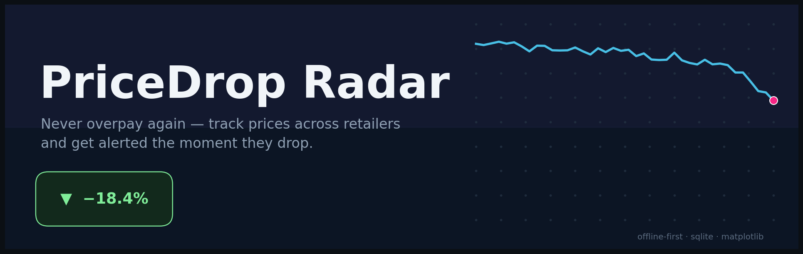
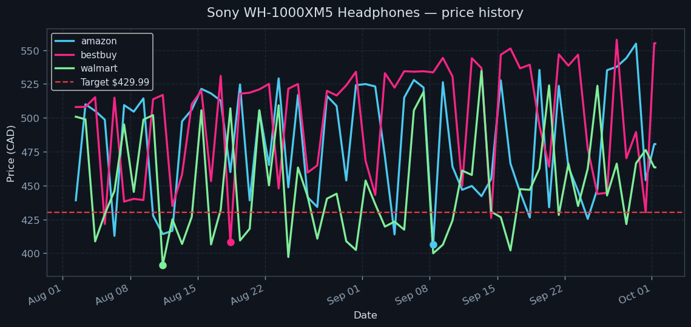
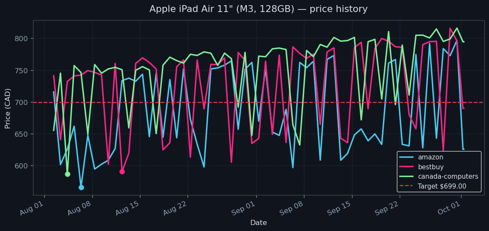

# PriceDrop Radar

> **Never overpay again.** Track product prices across retailers and get alerted the moment they drop — offline-first, zero API keys, running in under a minute.

[](https://github.com/872000/pricedrop-radar/actions)
[](https://www.python.org/)
[](https://github.com/872000/pricedrop-radar/releases)
[](LICENSE)

PriceDrop Radar watches the products you care about across multiple retailers, stores every price point in SQLite, evaluates drop-alert rules, and renders a shareable HTML dashboard with embedded price-history charts. It ships with a **demo mode** that synthesizes realistic price histories completely offline — no accounts, no API keys, no network.

## Screenshots

Real output from a single demo run — charts rendered by matplotlib from synthesized data:

| Sony WH-1000XM5 | iPad Air 11" (M3) |
|---|---|
|  |  |

The dashboard (`index.html`) embeds one chart per watched product plus an alert feed:

```
$ python -m pricedrop_radar demo --out demo-output
== step 2/3: evaluating alert rules ==
🎯 [below_target] Apple iPad Air 11" (M3, 128GB) @ amazon: $625.36 is at/below target $699.00
📉 [drop_vs_avg]  Apple iPad Air 11" (M3, 128GB) @ amazon: $625.36 is 9.5% below the 30-day average $691.26
```

## Features

- 📋 **Watchlist config** — declare products in `config/watchlist.json`: name, target price, retailers, per-product drop sensitivity (`drop_pct`).
- 🛒 **Multi-retailer fetchers** — pluggable fetcher per retailer (Amazon, Best Buy, Walmart, Canada Computers). Demo mode synthesizes deterministic, realistic price histories (promo cycles, weekly rhythms, drift) with zero network. Live fetchers degrade gracefully — they warn and skip instead of crashing.
- 🗄️ **SQLite price history** — append-only store with indexed lookups: latest price, 30-day average, all-time low, per-product/retailer history.
- 🔔 **Alert rules** — three evaluated by `check`:
  - price at/below your **target price**
  - price dropped ≥ `drop_pct`% vs the **30-day average**
  - price hit an **all-time low**
- 📊 **HTML dashboard** — `dashboard` builds a single `index.html` with embedded base64 chart PNGs (one per product), alert feed, and latest/average/low summary tables.
- 🧪 **Tested** — 37 unit + end-to-end tests; `python -m pytest` passes from the project root.

## Tech stack

| Layer | Choice |
|---|---|
| Language | Python 3.10+ (stdlib-first: `argparse`, `sqlite3`, `dataclasses`) |
| Charts | matplotlib (Agg backend, headless-safe) |
| Storage | SQLite (single file, no server) |
| Config | JSON watchlist (YAML-shaped, zero extra deps) |
| Tests | pytest |

No third-party services, no API keys, no network access required.

## Quickstart

```bash
# 1. Clone and enter the project
git clone https://github.com/872000/pricedrop-radar.git
cd pricedrop-radar

# 2. Run the full demo pipeline (works offline, ~10 seconds)
python3 -m pricedrop_radar demo --out demo-output

# 3. Open the dashboard
#    → demo-output/index.html  (double-click, or: python3 -m http.server --directory demo-output)
```

Individual steps:

```bash
python3 -m pricedrop_radar fetch --backfill   # record prices (demo data)
python3 -m pricedrop_radar check              # evaluate alert rules
python3 -m pricedrop_radar chart --out charts # render PNG charts
python3 -m pricedrop_radar dashboard          # build dashboard/index.html
```

Run the test suite:

```bash
python3 -m pip install pytest        # or: python3 -m venv .venv && .venv/bin/pip install pytest
python3 -m pytest                    # 37 tests, from the project root
```

### Make it yours

Edit `config/watchlist.json` — add products, set your target prices, pick retailers:

```json
{
  "products": [
    {
      "name": "Sony WH-1000XM5 Headphones",
      "target_price": 429.99,
      "retailers": ["amazon", "bestbuy", "walmart"],
      "drop_pct": 5.0,
      "currency": "CAD"
    }
  ]
}
```

Then re-run `python3 -m pricedrop_radar demo` and watch your own radar come alive.

## Project structure

```
pricedrop-radar/
├── pricedrop_radar/        # the package
│   ├── cli.py              # argparse CLI: fetch / check / chart / dashboard / demo
│   ├── config.py            # watchlist loading + validation (dataclasses)
│   ├── fetchers.py         # DemoFetcher (offline, deterministic) + LiveFetcher stubs
│   ├── store.py            # SQLite price-history store
│   ├── alerts.py           # alert rule engine (target / drop-vs-avg / all-time-low)
│   ├── charts.py           # matplotlib price-history charts
│   └── dashboard.py        # HTML dashboard with embedded base64 charts
├── config/watchlist.json   # bundled demo watchlist (3 products, 4 retailers)
├── tests/                  # 37 tests: config, store, alerts, fetchers, CLI e2e
├── docs/
│   ├── hero.png            # banner (generated with matplotlib)
│   └── screenshots/        # real charts produced by the demo run
├── tools/make_hero.py      # script that regenerates the hero banner
└── data/                   # SQLite db lives here at runtime (git-ignored)
```

## Roadmap

- [ ] Real retailer fetchers (Amazon PA-API, Best Buy, Walmart) behind the `live` mode with polite rate limiting
- [ ] Email / webhook notifications for alerts (SMTP, Discord, Slack)
- [ ] Scheduled checks via cron/systemd timer with a one-command installer
- [ ] Price-prediction trend line ("buy now or wait?")
- [ ] Multi-currency support with live FX rates
- [ ] Export history to CSV/Parquet

## License

MIT — see [LICENSE](LICENSE). Copyright (c) 2026 Parth (872000).
